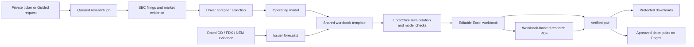

# Equity Research Builder

Enter a ticker to build an editable valuation workbook and a research PDF that reads the finished workbook. The [public portfolio](https://svemired-oss.github.io/equity-research-builder/) offers verified dated GD, FDX and NEM downloads and a benchmark summary. The live builder is intended for private use.

## Scope

The shared operating path targets U.S. non-financial operating companies with comparable SEC periods and verified market inputs. It supports automated research and Guided edits with recorded reasons. The dated GD, FDX and NEM paths retain their company-specific forecasts and valuation methods while using the same workbook structure and spreadsheet engine. Nintendo and the specialty valuation paths retain separate modeling methods.

## Architecture



The live research agent selects among evidence-backed options. Financial figures come from normalized filings, dated market data and labeled analyst assumptions. The report draws its figures from the recalculated workbook. The generic report verifies extracted claims, source links and the workbook hash. The dated issuer reports verify their model-specific values and exact workbook partner.

## What works today

| Workflow | Verified evidence |
| --- | --- |
| Public portfolio | Signed-out Chrome downloaded both files for GD, FDX and NEM and matched their published hashes. |
| General U.S. operating path | The last complete published 50-ticker benchmark recorded **9 verified pairs (18%)**, up from **7/50 (14%)** in Phase 0. These are earlier benchmark results. |
| Guided editing | An offline acceptance test queued three edits, downloaded both files and verified the workbook and report against the same edited assumptions. |
| Dated issuer migration | GD, FDX and NEM regenerated on the shared template. All six spot and 12-month target values matched the published pairs to six decimal places. |

| Dated issuer | Spot value/share | 12-month target/share |
| --- | ---: | ---: |
| General Dynamics | $303.28 | $321.85 |
| FedEx | $333.01 | $354.72 |
| Newmont | $57.98 | $61.12 |

The [full 50-ticker Phase 1 report](benchmarks/results.md) groups remaining failures. Revenue reconciliation (17) and missing financial facts (12) were the most common. The Phase 8 target is **above 60%** on a fresh run of that same cohort. A new credentialed run is required to measure it.

## Run privately

Install Python 3.12 and LibreOffice Calc, then install `requirements-dev.txt` in a virtual environment. Run the offline tests with `python -m pytest -q`. Store SEC contact and provider keys in the host secret manager. [Portable setup](docs/portable-builder.md)

Use the existing private [Codespaces setup](https://github.com/svemired-oss/equity-research-builder/tree/codespaces-demo) or the [prepared Render configuration](docs/phase-7.md). The Render deployment still requires account access and spending approval.

Check dated parity with the project’s private `inputs/` and `outputs/` directories. This produces new, independently checked pairs for the exact published cutoffs.

```sh
python scripts/reference_parity.py --root /path/to/private-project --output private/reference-parity
```

For current coverage, collect and replay the fixed 50-ticker benchmark using the configured providers and a new cache. Keep the collected market and filing evidence private.

```sh
python scripts/benchmark.py --collect --as-of 2026-11-19 --cache private/phase8-cache --output private/phase8-collection.md
python scripts/benchmark.py --cache private/phase8-cache --output private/phase8-results.md
```

## Known limitations

- Unreconciled financial facts, stale market data, unsupported acquisitions and missing peer inputs can stop a live run. Driver coverage is limited by the disclosures the parser can verify.
- Dated issuer regeneration needs the normalized evidence and the archived public files for parity comparison. The GD workbook authoring step uses no original GD V4 template.
- GitHub Pages has the three dated pairs. The ten additional benchmark pairs need a qualifying fresh run and release review.
- Phase 1’s mechanical pass rate describes verified file generation. Investment judgments and model assumptions still require analyst review.

See the [model backlog](docs/model-backlog.md) for issuer evidence and modeling gaps.
